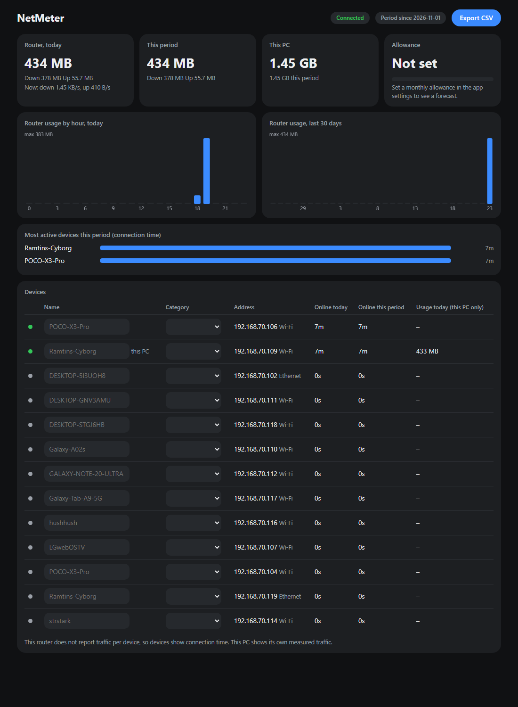

# NetMeter

A light Windows app that records how much internet your home network uses, shows it in a clean dashboard, and lets you
name and group every device on the network. Built for **Huawei 5G CPE routers** (tested on the H155-383, "5G CPE 5").

Everything stays on your PC. Nothing is sent anywhere.

<p align="center">
  
  
  
</p>

(The screenshots use made-up demo data.)

## What it shows

- **Router usage:** today, this billing period, live speed, usage by hour, and the last 14 or 30 days. The numbers come
  from the router itself, so they are exact.
- **This PC:** how much this computer used, measured from the Windows network adapter counters.
- **Allowance and forecast:** set a monthly allowance in GB, see a bar, a forecast for the end of the period, and get
  alerts at 80, 90 and 100 percent.
- **Devices:** every device the router has seen, online or offline, and how long it was online today and this period.
  Give each device a **name** and a **category** (Phone, Computer, Tablet, TV, Console, Smart home, Guest, Other).
- **New device alert** when something you have not seen before joins the network.
- **Browser dashboard:** the same data in your browser (`http://127.0.0.1:47854/`), with the same device editing.
  Open it from the tray icon, the button on the Home page, or Settings.
- **CSV export** of the daily totals and of the per-device history.
- Runs in the tray and can start with Windows (Settings, "Start with Windows").

<p align="center"></p>

## Important: per-device traffic

The Huawei web API has fields for the traffic of each device (`system/HostInfo`, `TxKBytes` and `RxKBytes`), but the
H155-383 firmware fills them with zeros even while a device downloads at full speed. NetMeter handles this on its own:

- If your router reports real per-device counters, NetMeter records them and shows usage per device.
- If it does not (like the H155-383), devices show **connection time** instead, and the PC NetMeter runs on shows its own
  measured traffic. The router total is always exact.

The router also has a hidden packet capture tool (developer mode). Using it for continuous accounting is not
implemented: captures are short and the router encrypts the request bodies of that page.

## Install

Download `NetMeter-Setup-0.2.0.exe` from the [latest release](../../releases/latest) and run it. It installs for the
current user only (no administrator rights) and adds a Start menu entry.

Then open **Settings**, enter the router address (your gateway, for example `192.168.1.1`), the username and the
password of the router's web panel, and press **Save and connect**.

> **The username is case sensitive.** On the CPE 5 it is `Admin` with a capital A.

### Login safety

The router counts wrong passwords and then locks logins for several minutes. NetMeter therefore tries a wrong password
**once** and then stops until you change the settings or press **Try again**. The password is stored encrypted with
Windows DPAPI, for your Windows user only. NetMeter keeps one session open; opening the router's web panel in your
browser signs NetMeter out, and it signs in again by itself.

## Where the data is

`%APPDATA%\NetMeter` holds `config.json`, `history.json` (small; about 400 days are kept) and `netmeter.log`.

## Build from source

You need Flutter (stable, 3.47 or newer) with Windows desktop support.

```powershell
flutter pub get
flutter test                       # checks the login maths against the router's own CryptoJS
flutter build windows --release    # build\windows\x64\runner\Release\netmeter.exe
```

To build the installer, install [Inno Setup 6](https://jrsoftware.org/isinfo.php) and run
`ISCC installer\netmeter.iss` after the release build.

Demo mode for screenshots: `netmeter.exe --demo --page=0 --screenshot=out.png` (made-up data, no router needed; set
the environment variable `NETMETER_DATA` to a scratch folder so the demo never touches your real data).

Developer tools in `tool/`: `probe.dart` logs in once and prints the host table and totals of a real router (the
password goes in the `NM_PW` environment variable); `setup_config.dart` writes the settings file.

## Other routers

Only the Huawei HiLink web API is implemented, in `lib/core/huawei_client.dart`. Adding another brand means writing a
client that returns the same two things: the host list (`HostRecord`) and the WAN totals (`WanStat`). Pull requests are
welcome.

## License

GPL-2.0-or-later. The Huawei login flow is a Dart port of [CPE-Monitor](https://github.com/DrADCalcium/CPE-Monitor).
See [NOTICE](NOTICE) for the full list of third-party components.
