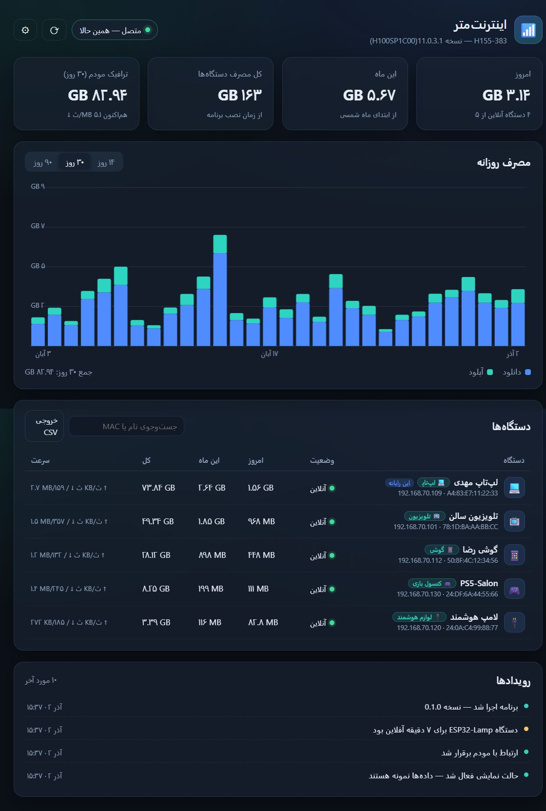

# NetMeter — اینترنت‌متر

پایشگر سبک مصرف اینترنت **به تفکیک دستگاه** روی ویندوز. برنامه از پنل مدیریت
مودم، شمارنده‌ی ترافیک هر دستگاه را می‌خواند، در یک پایگاه‌داده‌ی محلی (SQLite)
ذخیره می‌کند و یک داشبورد فارسی راست‌به‌چپ با نمودار روزانه نشان می‌دهد.

> داده‌ها فقط روی رایانه‌ی خودت می‌مانند. هیچ اطلاعاتی به بیرون فرستاده نمی‌شود.




> تصویر: حالت نمایشی (داده‌های نمونه) برای دیدن ظاهر برنامه.

## دانلود و نصب

آخرین نسخه‌ی نصبی را از [Releases](../../releases/latest) بگیر
(`NetMeter-Setup-x.y.z.exe`) و دوبار کلیک کن.

- نصب در `%LOCALAPPDATA%\NetMeter` — **بدون نیاز به دسترسی ادمین**
- میان‌بر روی دسکتاپ و منوی استارت
- حذف از **Settings → Apps**

### نصب با اسکریپت (بدون Setup)

```powershell
git clone https://github.com/RamtinGhiami/NetMeter.git
cd NetMeter
powershell -ExecutionPolicy Bypass -File netmeter\install.ps1 -Start
```

### اجرای مستقیم از سورس

```powershell
pip install -r netmeter\requirements.txt
python -m netmeter
```

مرورگر روی <http://127.0.0.1:8787/> باز می‌شود. اولین بار **راه‌اندازی** را بزن
و آدرس مودم، نام کاربری و رمز پنل را وارد کن.

برای دیدن ظاهر بدون مودم:

```powershell
python -m netmeter --demo --port 8899
```

## امکانات

- مصرف **امروز / این ماه / کل** برای هر دستگاه (دانلود و آپلود جدا)
- **نام دلخواه و دسته‌بندی** هر دستگاه (گوشی، لپ‌تاپ، تلویزیون، کنسول و…)
- نمودار ستونی ۱۴ / ۳۰ / ۹۰ روزه + تاریخچه‌ی ۳۰ روزه‌ی هر دستگاه
- تشخیص آنلاین/آفلاین و سرعت لحظه‌ای
- شروع خودکار با ویندوز (اختیاری، HKCU، بدون ادمین)
- خروجی CSV از مصرف دستگاه‌ها و ترافیک مودم
- رمز مودم با **DPAPI ویندوز** رمزنگاری می‌شود
- رابط وب فقط روی `127.0.0.1` گوش می‌دهد
- سبک: ~۲۴ مگابایت، ~۴۵ مگابایت حافظه، بدون سرویس یا درایور

## پشتیبانی مودم‌ها

| برند / سیستم | وضعیت | منبع آمار هر دستگاه |
|---|---|---|
| Huawei HiLink / 5G CPE (H153, H155, H165, …) | ✅ | `system/HostInfo` |
| TP-Link Archer | 🔜 | `admin/data/network_map` |
| OpenWrt / LEDE | 🔜 | `ubus` / `nlbwmon` |
| AsusWRT | 🔜 | `appGet.cgi` |
| MikroTik RouterOS | 🔜 | REST / SNMP |
| سایر مودم‌ها | ⚠️ | فقط ترافیک کل (WAN) |

مودم تست‌شده: **Huawei H155-383 (5G CPE 5)**.

افزودن برند جدید = نوشتن یک کلاس در `netmeter/routers/`؛ بقیه‌ی برنامه تغییری
لازم ندارد.

## ساخت EXE و Setup

```powershell
powershell -ExecutionPolicy Bypass -File netmeter\build.ps1
```

| خروجی | توضیح |
|---|---|
| `netmeter\dist\NetMeter\NetMeter.exe` | نسخه‌ی portable |
| `netmeter\dist\NetMeter-Setup-x.y.z.exe` | نسخه‌ی نصبی (نیازمند [NSIS](https://nsis.sourceforge.io/) 3) |

بدون NSIS فقط EXE ساخته می‌شود؛ برای نصب همیشه می‌توانی از `install.ps1`
استفاده کنی.

## مستندات کامل

راهنمای کامل فارسی (تنظیمات، عیب‌یابی، نحوه‌ی محاسبه‌ی مصرف، ساختار کد):

👉 [`netmeter/README.md`](netmeter/README.md)

## حریم خصوصی و امنیت

- داشبورد پیش‌فرض فقط از `127.0.0.1` در دسترس است.
- رمز مودم با DPAPI رمزنگاری می‌شود و فقط با همان حساب ویندوز باز می‌شود.
- برنامه هیچ داده‌ای به بیرون نمی‌فرستد؛ تنها ارتباطش با آدرس مودم است.
- برای امنیت بیشتر، در مودم یک حساب فقط-خواندنی بساز.

## مجوز

این پروژه تحت **GPL-2.0-or-later** منتشر می‌شود. متن مجوز در [LICENSE](LICENSE)
و منابع/اعتبارها در [NOTICE](NOTICE) است. جریان ورود SCRAM هوآوی بر پایه‌ی
پروژه‌ی [CPE-Monitor](https://github.com/Horizon-Digital-Solutions/CPE-Monitor)
پیاده‌سازی شده است.

---

### English

NetMeter is a lightweight, per-device internet usage monitor for Windows. It
reads per-host traffic counters from the router admin panel (Huawei HiLink /
5G CPE supported out of the box), stores them in a local SQLite database and
serves a Persian RTL dashboard with charts, custom device names and categories.
No admin rights, no background service, no data leaves the machine.
