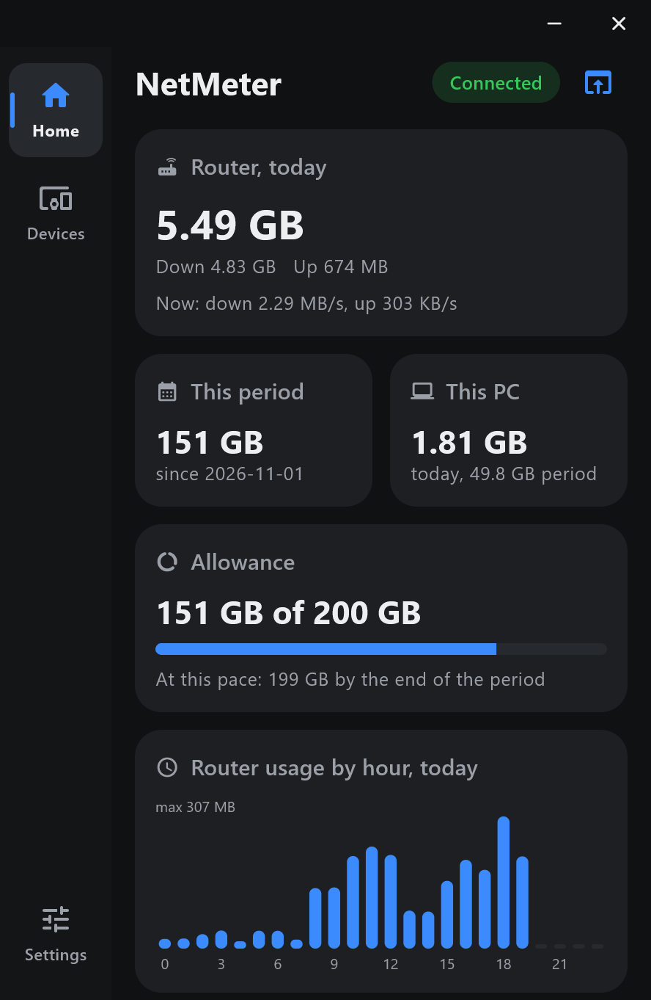
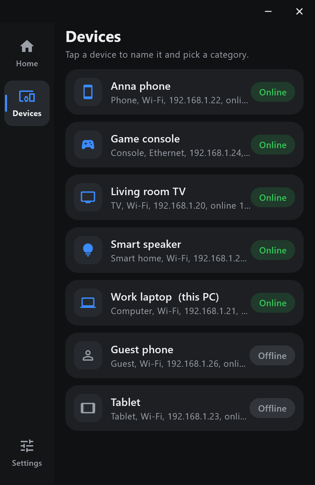
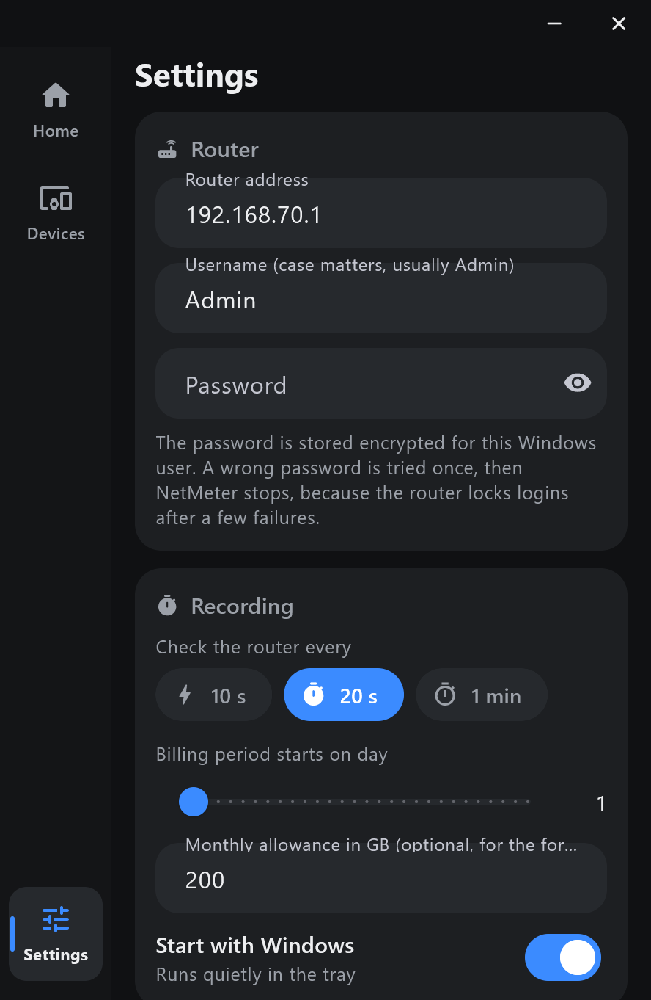

# NetMeter

A light Windows app that records how much internet your home network uses, shows it in a clean dashboard, and lets you
name and group every device on the network. Built for **Huawei 5G CPE routers** (tested on the H155-383, "5G CPE 5").

Everything stays on your PC. Nothing is sent anywhere.

<p align="center">
  
  
  
</p>

(The screenshots use made-up demo data.)

## What it shows

- **Router usage:** today, this billing period, live speed and usage by month. The numbers come from the router itself,
  so they are exact.
- **Day and month filter:** step back and forward through any day (bars per hour) or any month (bars per day) and see
  its totals, this PC and the most active devices.
- **This PC:** how much this computer used, measured from the Windows network adapter counters.
- **Allowance and forecast:** set a monthly allowance in GB, see a bar, a forecast for the end of the period, and get
  alerts at 80, 90 and 100 percent.
- **Devices:** every device the router has seen, online or offline, how long it was online, and (optional) an estimate
  of its usage.
  Give each device a **name** and a **category** (Phone, Computer, Tablet, TV, Console, Smart home, Guest, Other).
- **New device alert** when something you have not seen before joins the network.
- **Browser dashboard:** the same data in your browser (`http://127.0.0.1:47854/`), with the same device editing.
  Open it from the tray icon, the button on the Home page, or Settings.
- **CSV export** of the daily totals and of the per-device history.
- Runs in the tray and can start with Windows (Settings, "Start with Windows").

<p align="center"></p>

## Usage per device

The Huawei web API has fields for the traffic of each device (`system/HostInfo`, `TxKBytes` and `RxKBytes`), but the
H155-383 firmware fills them with zeros even while a device downloads at full speed. NetMeter handles this on its own:

- If your router reports real per-device counters, NetMeter records them and shows usage per device.
- If it does not (like the H155-383), devices show **connection time**, and the PC NetMeter runs on shows its own exact
  traffic. The router total is always exact.
- **Optional estimate (Settings, "Usage per device"):** the router has a developer packet capture. NetMeter switches it on
  for about 20 seconds every 1, 2 or 5 minutes, reads **only the addresses and sizes** of the packets (nothing else is
  kept and nothing is stored from the capture), and shares the exact router total among the devices in the proportion it
  saw. Every device on the router, Wi-Fi or cable, is included. Estimated numbers are marked with `~`.

How good is the estimate? Long uses (streaming, downloads, calls) come out well, because they are present in most
captures. A short burst that happens entirely between two captures can be missed, and its bytes are then shared among
whoever was active at the next capture. This PC is always exact (it uses the Windows counters). The total never changes.
The capture adds some load to the router while it runs, so the option is off by default.

## Download and install

Get the file for your system from the [latest release](../../releases/latest). The builds are made by GitHub Actions
(see `.github/workflows/release.yml`) for Windows, Linux and macOS.

| System | File | How |
| --- | --- | --- |
| **Windows 10 / 11** | `NetMeter-Setup-<version>.exe` | Run it. It installs for your user only (no administrator rights), adds a Start menu entry and can start with Windows. A portable `.zip` is also there. |
| **Linux** (x86-64, GTK 3) | `NetMeter-<version>-linux-x64.tar.gz` | Unpack it and run `./install.sh`. Or in one step: `curl -fsSL https://raw.githubusercontent.com/RamtinGhiami/NetMeter/main/scripts/install-linux.sh \| bash`. The tray icon needs AppIndicator support (on GNOME, install the "AppIndicator" extension). |
| **macOS** | `NetMeter-<version>-macos.dmg` (or `.zip`) | Open it and drag NetMeter to Applications. The app is not notarized: the first time, right-click it and choose Open, or run `xattr -dr com.apple.quarantine /Applications/NetMeter.app`. |

Windows is the tested platform. The Linux and macOS builds compile from the same code but have had far less testing, so
please report problems in the Issues tab. On Linux and macOS the router password is kept in the settings file, which is
readable only by your user (Windows uses its built-in DPAPI encryption).

Then open **Settings**, enter the router address (your gateway, for example `192.168.1.1`), the username and the
password of the router's web panel, and press **Save and connect**.

> **The username is case sensitive.** On the CPE 5 it is `Admin` with a capital A.

### Login safety

The router counts wrong passwords and then locks logins for several minutes. NetMeter therefore tries a wrong password
**once** and then stops until you change the settings or press **Try again**. The password is stored encrypted with
Windows DPAPI, for your Windows user only (Linux and macOS: in the private settings file). NetMeter keeps one session open; opening the router's web panel in your
browser signs NetMeter out, and it signs in again by itself.

## Where the data is

`%APPDATA%\NetMeter` on Windows, `~/.config/NetMeter` on Linux and `~/Library/Application Support/NetMeter` on macOS hold `config.json`, `history.json` (small; about 400 days are kept) and `netmeter.log`.

## Build from source

You need Flutter (stable, 3.47 or newer) with desktop support for your system. On Linux also install
`libgtk-3-dev`, `libayatana-appindicator3-dev`, `libkeybinder-3.0-dev`, `clang`, `cmake` and `ninja-build`.

```powershell
flutter pub get
flutter test                       # checks the login maths against the router's own CryptoJS
flutter build windows --release    # or: flutter build linux --release / flutter build macos --release
```

To build the installer, install [Inno Setup 6](https://jrsoftware.org/isinfo.php) and run
`ISCC installer\netmeter.iss` after the release build.

Demo mode for screenshots: `netmeter.exe --demo --page=0 --screenshot=out.png` (made-up data, no router needed; set
the environment variable `NETMETER_DATA` to a scratch folder so the demo never touches your real data).

Developer tools in `tool/`: `probe.dart` logs in once and prints the host table and totals of a real router (the
password goes in the `NM_PW` environment variable); `setup_config.dart` writes the settings file.

## Other routers

Only the Huawei HiLink web API is implemented, in `lib/core/huawei_client.dart`. Adding another brand means writing a
client that returns the same two things: the host list (`HostRecord`) and the WAN totals (`WanStat`). Pull requests are
welcome.

## License

GPL-2.0-or-later. The Huawei login flow is a Dart port of [CPE-Monitor](https://github.com/DrADCalcium/CPE-Monitor).
See [NOTICE](NOTICE) for the full list of third-party components.
